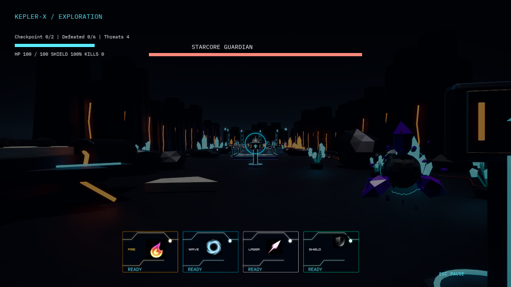

# Hand off My Planet

**用双手施法，用转头探索，与 COSMO 一起踏上外星冒险。**

Hand off My Planet 是一款基于 Unreal Engine 5.7 的第一人称游戏。普通摄像头识别玩家的双手和头部动作：左手控制前进与后退，转头改变视角，右手释放护盾、火球、冲击波和激光。你将在外星地表探索、与怪物战斗，并挑战星核守卫。

AI 伙伴 **COSMO** 支持 Grok 实时语音对话和互动教学。基础探索与战斗可以在没有 API Key 的情况下运行。



## 游戏玩法

从飞船降落区出发，探索能量峡谷和星核遗迹，在训练靶上熟悉技能，并利用场景中的补给和检查点继续推进。当前关卡包含 5 只小怪、1 只 Boss，以及可扫描的非敌对水晶眼；**击败全部敌对目标后进入胜利界面**。

四种技能各有用途：

| 技能 | 战斗用途 |
| --- | --- |
| Shield · 护盾 | 抵挡正面攻击；持续消耗能量，解除后恢复，注意来自背后的敌人。 |
| Fire · 火球 | 发射远程投射物，适合对准目标进行单次打击。 |
| Wave · 冲击波 | 攻击近距离前方区域，打断并击退小怪。 |
| Laser · 激光 | 通过捏合持续发射，移动捏合位置瞄准，松开即停止。 |

留意 Boss 的攻击预警，在其攻击后的恢复阶段集中输出。HUD 会显示生命、护盾能量、技能冷却、击杀数和 Boss 血条。死亡后可以用双掌手势从检查点重试；胜利后可用同一手势重新开始。

## 手势操作

左右手均指**玩家自己的左右手**。让脸和双手处于摄像头取景范围，保持光线充足，并为手臂留出前推、后收和横挥的空间。

### 开始前校准

面向摄像头，头部朝正前方，左手张掌自然停在身体前方，稳定保持约 1 秒，等待识别就绪。需要重新校准时，双手做 V 手势保持 1.5 秒，然后放下 V 手势，再次保持头部和左手稳定。

### 移动、战斗与交互

| 身体动作 | 游戏行为 |
| --- | --- |
| 左手张掌，向摄像头前推 | 前进 |
| 左手张掌，向身体方向后收 | 后退 |
| 左手握拳 | 立即停止移动 |
| 头部向左 / 向右转动 | 左转 / 右转；回正后停止转向 |
| 右手张掌并保持稳定 | 开启护盾；收手解除 |
| 右手握拳后向摄像头推出 | 发射火球；收回后可再次准备 |
| 右手横向挥动 | 释放冲击波 |
| 右手拇指与食指捏合 | 持续激光，捏合中心用于瞄准；松开停止 |
| 右手仅伸直食指，保持 0.6 秒 | 开始扫描准星指向的敌人或扫描对象 |
| 双手 V 手势，保持 1.5 秒 | 重新校准 |
| 死亡 / 胜利界面，双手张掌保持 1.5 秒 | 检查点重试 / 重新开始 |

识别层还保留了“右手 V 保持 1 秒请求教学提示”和“左手 V 保持 1 秒重复提示”。这两项用于教程指令模式；**当前星球关卡默认采用自由对话模式，不触发这两项教学指令**。启用 Grok 语音后，可以直接向 COSMO 提问。

扫描和重试等保持手势，每次连续保持只触发一次；收手或更换姿势后才能再次触发。手部或面部丢失跟踪时，对应的移动、转向或持续技能会停止。

### 菜单操作

移动和施法使用手势，菜单支持鼠标点击，也可用方向键 / Tab 选择、Enter / Space 确认。游戏中按 Esc 暂停，再按一次恢复；暂停菜单可调整语音音量、静音麦克风或返回主菜单。

## 项目运行方法

### 1. 准备环境

| 环境 | 要求 |
| --- | --- |
| 操作系统 | Windows 64 位；当前自动运行与打包流程面向 Win64。 |
| 游戏引擎 | Unreal Engine 5.7。 |
| 编译工具 | Visual Studio 的 C++ 游戏开发工具及适配 Unreal 的 Windows SDK，用于编译项目插件。 |
| Python | **CPython 3.12.10 x64**；运行包生成器会检查完整版本号。 |
| 输入设备 | 摄像头；使用实时语音时还需要麦克风和音频输出设备。 |
| 网络 | 首次安装 Python 依赖、下载内嵌 Python，以及使用 Grok 服务时需要联网。 |

### 2. 克隆项目并生成运行环境

在 PowerShell 中运行：

```powershell
git clone https://github.com/FranHoward/Hand-off-My-Planet.git
Set-Location Hand-off-My-Planet

# 确认这里显示 Python 3.12.10，并使用 64 位解释器。
python --version
python -m venv .venv
.\.venv\Scripts\python.exe -m pip install -r Scripts/runtime-requirements.lock
.\.venv\Scripts\python.exe Scripts/build_runtime.py
```

生成结果位于 `Plugins/CosmoBridge/Resources/Runtime/Win64/`，包含独立 Python、依赖、服务代码和识别模型。游戏使用这份运行包，因此**必须先生成它，再打开或编译首次克隆的项目**。

可以在打开 Unreal 前进行离线运行包检查：

```powershell
.\Plugins\CosmoBridge\Resources\Runtime\Win64\python\python.exe -B `
  .\Plugins\CosmoBridge\Resources\Runtime\Win64\app\runtime_check.py
```

运行包生成器会拒绝覆盖已有输出。修改服务或识别源码后需要重新生成，具体备份、重建和验证步骤见 [运行环境部署](RUNTIME_DEPLOYMENT.md)。

### 3. 打开游戏并快速试玩

1. 用 UE 5.7 打开 `VFX.uproject`，出现编译插件提示时允许编译，等待资源和着色器准备完成。
2. 默认地图是主菜单 `Content/UI/Maps/Lvl_MainMenu`。点击编辑器的 **Play**，再点击 **START MISSION**。
3. 在 **SKIP TUTORIAL?** 弹窗选择 **CONFIRM**，即可跳过语音教程进入关卡；此路径不需要 API Key。
4. 允许桌面应用使用摄像头，面向镜头完成校准，然后用手势移动和施法。
5. 停止 Play 时，游戏会关闭本次自动启动的识别进程并释放摄像头。

游戏会自动管理所需的本机 COSMO 服务和手势识别进程，无需单独打开识别窗口。没有 API Key 时使用本地 mock 服务，实时 Grok 对话不可用。

### 4. 可选：开启 COSMO 语音与互动教程

要体验 Grok 实时对话和开场教学，配置可用的 `XAI_API_KEY`。`GROK_API_KEY` 也可作为别名。**仅使用实时语音时不要求设置 `XAI_MODEL`**；该变量用于额外启用 HTTP 文本问答模型。

一种临时配置方式是在 PowerShell 中输入密钥，并从同一个窗口启动 Unreal。先关闭已打开的项目，再执行：

```powershell
$grokSecret = Read-Host '输入 xAI API Key' -AsSecureString
$env:XAI_API_KEY = [System.Net.NetworkCredential]::new('', $grokSecret).Password
Remove-Variable grokSecret
$env:COSMO_AI_PROVIDER = 'auto'

# 修改为本机 UnrealEditor.exe 的实际路径。
$unrealEditorPath = 'C:\Program Files\Epic Games\UE_5.7\Engine\Binaries\Win64\UnrealEditor.exe'
& $unrealEditorPath (Resolve-Path .\VFX.uproject).Path
```

也可以通过 Windows 的用户环境变量设置 `XAI_API_KEY`；服务启动时会读取持久化配置。密钥应保存在环境变量中，避免写入源码或提交到仓库。

在主菜单点击 **START MISSION** 后：

- 选择 **CONFIRM**：直接进入游戏，可与 COSMO 自由语音交流。
- 选择 **CANCEL**：进入 Grok 开场对话与 9 项互动教程，完成后进入同一关卡。教程会先朗读指令，等待你做出正确动作，再播放反馈并继续。

如果语音连接或播放失败，界面会显示原因；Enter 重试，Esc 返回主菜单。进入关卡后等待语音状态就绪再说话，例如“COSMO，怎样使用护盾？”或“我应该怎样对付 Boss？”。

默认语音模型和音色由 `Scripts/runtime-defaults.json` 配置，也可通过 `XAI_VOICE_MODEL`、`XAI_VOICE` 环境变量覆盖。更多连接、调试和服务端说明见 [COSMO 接入文档](COSMO_INTEGRATION.md)。

## 常见问题

| 问题 | 处理方法 |
| --- | --- |
| 编译提示 `Missing COSMO runtime` | 先完成运行包生成步骤，确认 `Plugins/CosmoBridge/Resources/Runtime/Win64/manifest.json` 存在。 |
| 生成器提示 Python 版本不匹配 | 使用 CPython **3.12.10 x64** 创建构建环境，并安装锁定依赖。 |
| 生成器提示 `Output exists` | 按 [运行环境部署](RUNTIME_DEPLOYMENT.md) 备份已有输出后重建。 |
| 摄像头打不开或没有手势响应 | 检查 Windows 摄像头权限，关闭占用设备的应用，并查看 `Saved/Logs/GestureRecognition.log`。教程识别日志为 `TutorialGestureRecognition.log`。 |
| 摄像头选错、左右手相反或转向相反 | 在角色 `FirstPersonAIIntegration` 组件调整 `CameraIndex`、`SwapHands`、`InvertHeadTurn`；教程阶段在 `BP_PlanetHUD` 的 `Tutorial/Camera` 中调整对应设置。 |
| 开场教程停在语音连接页面 | 检查 API Key、网络和音频设备，查看 `Saved/Logs/CosmoService.log`；未配置语音时可返回主菜单并选择跳过教程。 |
| 希望不使用 Grok 先试玩 | 在 `SKIP TUTORIAL?` 弹窗选择 **CONFIRM**。 |

本机默认端口为：COSMO HTTP `8765`、实时语音 `8766`、摄像头预览 `8767`、手势 UDP `5052`。停止其他测试实例，避免端口或摄像头被重复占用。

## 项目结构

| 路径 | 内容 |
| --- | --- |
| `VFX.uproject` / `Config/` | Unreal 项目入口与默认配置。 |
| `Content/` | 已导入的关卡、角色、蓝图、UI 和游戏素材。 |
| `Plugins/CosmoBridge/` | 战斗与关卡逻辑、COSMO 服务管理、语音和 HUD。 |
| `Plugins/GestureBridge/` | 接收识别结果并向 Unreal 传递动作。 |
| `dubhack_gestures/` | 手部 / 面部识别、动作判定、配置、模型和测试。 |
| `External/CosmoSystem/` | COSMO Python 服务、对话和教程逻辑。 |
| `External/` | 原始美术、动画、UI 与可再导入资源。 |
| `Scripts/` | 运行包生成、服务启动、资源导入与验证脚本。 |

仓库保留源码、关卡、游戏素材和原始识别模型。`.gitignore` 排除 Unreal 编译产物、缓存、日志、自动备份、Python 虚拟环境和可重新生成的独立运行包。

分发 Windows 游戏时应提供完整打包目录，包含随包运行环境。打包方法与迁移验证见 [运行环境部署](RUNTIME_DEPLOYMENT.md)。

## 开发文档

- [手势配置与识别诊断](GESTURE_ONLY.md)
- [COSMO、实时语音与接口](COSMO_INTEGRATION.md)
- [AI 角色接入](BP_FIRST_PERSON_AI.md)
- [关卡设计与战斗参数](ALIEN_PLANET_LEVEL.md)
- [生物动画资源](CREATURE_ANIMATIONS.md)
- [当前菜单与互动教程流程](Content/UI/README.txt)

部分专题文档保留了早期实现记录；当前入口、教程选择、胜利条件和运行方法以本 README 及实际源码为准。
